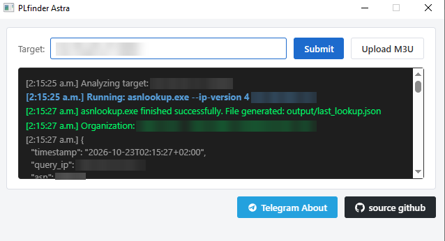
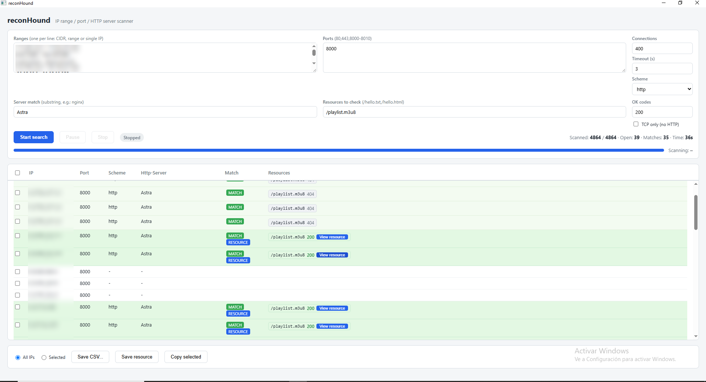
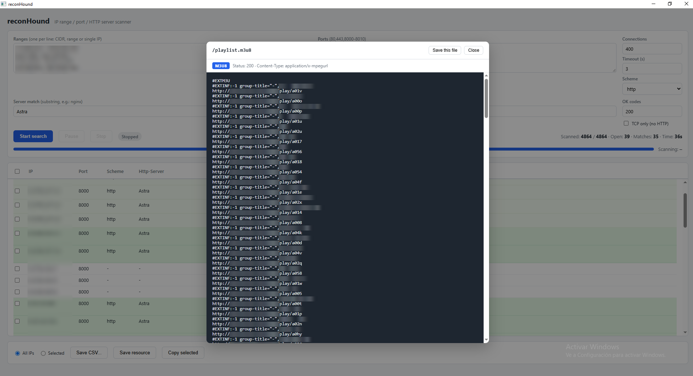

# PLfinder

An example tool for scanning open Cesbo Astra lists in order to audit and secure them.

## Screenshots

<p align="center">
  <a href="preview/screen1.png"></a>
  <a href="preview/screen2.png"></a>
  <a href="preview/screen3.png"></a>
</p>

<p align="center"><sub>Click an image to view it full size.</sub></p>

## Prerequisites

Before running the application, make sure you have the following binaries placed in the **same folder**:

- `asnlookup.exe`
- `reconhound.exe`

---

## Usage

To start the application:

```bash
.\PLfinder.exe
```

---

## Legal Disclaimer and Ethical Use

This tool was developed **solely for educational, research, and security auditing purposes**.